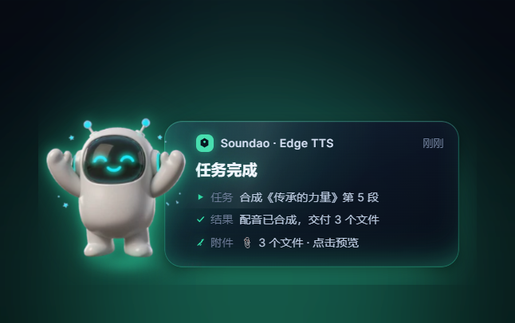
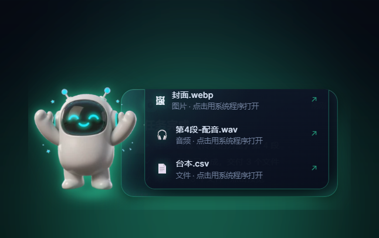
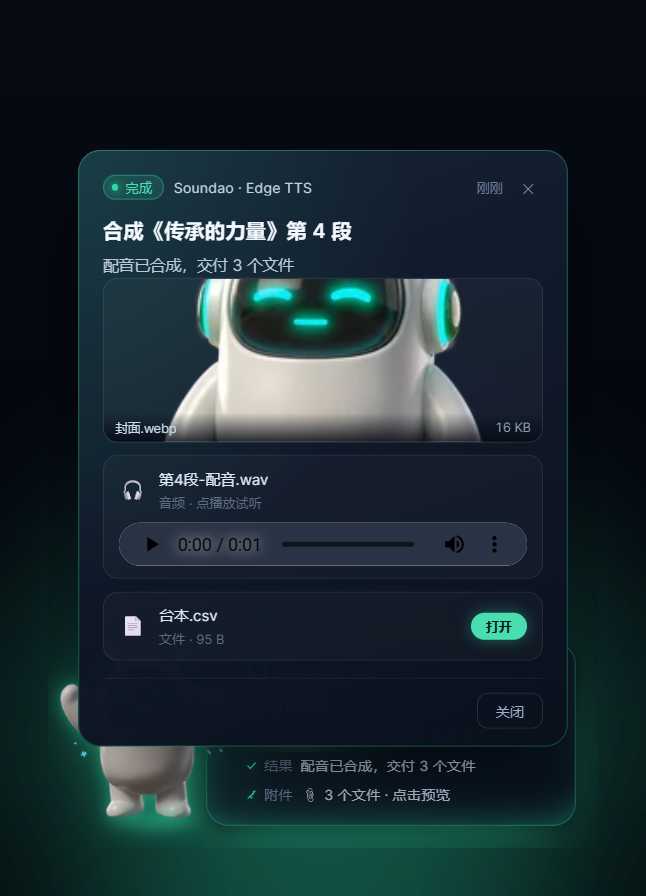

# EchoCast

任务结果通知客户端。任务跑完之后，界面上轻轻回应一声，而不是弹一个系统提醒。

Tauri 2 + Vue 3 + TypeScript + Vite。

> **[🌐 在线互动演示](https://echocast.wen-dao.top)** —— 左侧扮演服务端推帧，右侧就是客户端本体。
> 支持**上传本机文件**：选几个文件 → 推送任务 → 通知带着附件直达 → 预览 / 下载，
> 与真实客户端 `media[]` 附件走的是同一条链路。

<p align="center">
  
</p>

## 界面一览

<p align="center">
  
  
</p>
<p align="center"><sub>任务完成时 robot 欢呼亮相；点它弹出<b>交付清单</b>——正文链接、动作、media 文件统一收口，逐项打开。</sub></p>

<p align="center">
  
</p>
<p align="center"><sub>点「📎 N 个文件」进入详情面板：图片缩略 / 音视频播放 / 文件卡片下载，附件已预取进本地缓存，断网也能回看。</sub></p>

## 特性

- **桌面通知气泡 / 顶部灯条**：同一份通知两种摆法，设置里一键切换；右下角气泡带形象、进度与动作按钮，顶部灯条一行收纳、无通知时整条收起。
- **问询（ask）**：需要人拍板的任务常驻屏幕、专用提示音、18 秒追问最多三次，答复后等服务端回执才算数（ack / nack / 待确认三态）。
- **多媒体附件**：图片 / 音频 / 视频 / 文件卡片，收到的附件自动预取到本地缓存后展示；交付文件点开即用系统默认程序打开。
- **可换形象包**：气泡里的机器人是一套可整包替换的素材，内置包 + 用户导入包 + 随安装包分发的定制管线（AI 生图 → 抠图 → 打包）。
- **多服务端点**：保存多套「地址 + 令牌 + 订阅」一键切换；没有服务端时点「使用本地服务端」，内置演示服务端立刻起在 127.0.0.1 并推一轮完整任务。
- **提示音四态 + 问询音**：开始 / 完成 / 警告 / 失败各一个合成音，问询 dididi 会追问；三处静音入口（按钮 / 面板 / `Ctrl+Shift+M`），静音是硬闸门。
- **托盘常驻**：关窗口缩进托盘继续守通知，托盘菜单自带连接状态与静音开关。
- **隐蔽调试帧日志**：设置页底栏路径 3 秒内连点 5 次，看服务端发来的每一帧原文。

安装包（Windows）：`pnpm tauri build` 产出 MSI / NSIS 两种安装器，约 2–3 MB。

## 开发

```bash
pnpm install
pnpm dev          # 只跑前端，浏览器访问 http://localhost:1420
pnpm tauri dev    # 跑完整桌面端
pnpm build        # 类型检查 + 构建前端
```

> **Windows 上的编译陷阱**：这台机器上增量编译会让 `rustc` 在删除
> incremental 锁文件时拿到「拒绝访问」，然后以 0% CPU 无限等待 ——
> 表现是编译停在某个 crate 上十几分钟毫无进展。`src-tauri/.cargo/config.toml`
> 里已经把 `CARGO_INCREMENTAL` 设为 `0` 绕过，不需要手动加环境变量。
> 如果之后不再复现，删掉那一段就能恢复增量编译。

## 连接服务端

窗口右上角**齿轮**（或点状态灯）打开设置面板，填服务端地址后点「连接」。

```
ws://127.0.0.1:8766/ws     ← 推荐写法
http://127.0.0.1:8766/ws   ← 自动转成 ws
127.0.0.1:8766/ws          ← 裸地址自动补 ws://
```

| 行为 | 说明 |
|---|---|
| 存盘位置 | `%APPDATA%\com.echocast.client\settings.json`，设置面板底部可点复制 |
| 鉴权 | 握手时带 `Authorization: Bearer <token>`。**token 与一台终端一一对应**，空着就不发这个头 |
| 终端身份 | 连上后先发 `{op:"hello"}` 自报设备与标签，服务端用 `hello_ack` 下发 `terminal_id` |
| 订阅 | 连上后立刻发 `{op:"subscribe", topics:[…]}`。topic 只是**事件类型过滤器**，不参与路由 |
| 帧格式 | `{op:"notice", notice:{…}}` 信封；`{op:"subscribed"}` / `{op:"pong"}` 等控制帧会被静默丢弃 |
| 任务投递 | `{op:"task.deliver", task:{…}}`，收到后**自动回** `ack:seen` |
| 动作回传 | 点气泡按钮后走同一条连接上行 `{op:"action", notice_id, action_id, payload}` |
| 任务回执 | `{op:"ack", task_id, state}`，state 为 `seen` / `accepted` / `rejected` / `done` |
| 重连 | 无限指数退避 1s → 30s，服务端晚起也能自己连上 |
| **不重连** | token 无效（401 / close 4001）或被吊销（4003）时**停止重连**，提示用户改配置，避免刷爆服务端日志 |
| 心跳 | 每 25s 发 WS 协议层 `Ping`，只认标准 `Pong` |
| 配了地址后 | 本机 mock 自动停用，避免两路数据混在一起分不清真假 |
| 浏览器预览 | 没有 IPC，连接能力不可用，会明确提示 |

排查「连上了但什么都没有」时，用帧日志：

```bash
ECHOCAST_WS_LOG=1 ./target/debug/echocast.exe
# 逐帧记录在 %APPDATA%\com.echocast.client\ws-frames.log，形如：
# 1793452567509 ← {"op":"subscribed","topics":[...]}
# 1793452570079 ← {"op":"notice","notice":{"id":"task-soundao-055",...}}
```

这一行日志是「服务端没推」和「推了但字段不对」的唯一分界线 —— 界面上两种
情况长得一模一样：都是没有气泡。

通知契约见 [docs/notice-protocol.md](docs/notice-protocol.md)，终端路由与定向投递见
[docs/terminal-routing.md](docs/terminal-routing.md)，授权机制（两端对齐稿）见
[docs/auth.md](docs/auth.md)，**配置上手看 [docs/manual.md](docs/manual.md)（使用手册）**。

**路由的关键约束**：身份只能来自凭证，不能来自报文。客户端不会、也不该在帧里
自报 `terminal_id` —— 任何客户端可填的身份字段都等于没有权限。服务端按
`token → terminal_id` 绑定连接，再按 `target` 决定推给谁。

设置面板里的「本机身份」会显示服务端认下的 `terminal_id`、设备 id 和服务端下发的标签。
标签以**服务端为准**：客户端报的只是建议值，管理员改过的会覆盖回来。

手边没有服务端时，用自带的零依赖假服务端验证整条链路：

```bash
python tools/ws-demo.py          # 监听 8787：终端表 + token 鉴权 + 路由投递
python tools/ws-demo.py --card   # 只推 {topic,text,card}，验证客户端兼容层
python tools/ws-demo.py --plain  # 不建任务，只按连接推进度
python tools/ws-demo.py --quiet  # 什么都不自动推，只等 HTTP 指令（服务端驱动用这个）
```

`--route`（默认）模式下它带三台虚拟终端，token 分别是
`ect_demo_alpha` / `ect_demo_beta` / `ect_demo_gamma`，会每 9 秒轮流按
`terminal` / `label` / `broadcast` 建任务。也可以自己建：

```bash
curl http://127.0.0.1:8787/api/terminals
curl -X POST http://127.0.0.1:8787/api/tasks -H "content-type: application/json" \
     -d '{"target":{"kind":"label","labels":["办公"]},"title":"给办公组的机器"}'
```

带 `status` / `progress` 的请求走「直接推 notice」这条路，也就是真实服务端
最常用的形状 —— 同一个 `id` 反复推，客户端按 id 合并成一条在长进度：

```bash
# 开始
curl -X POST http://127.0.0.1:8787/api/tasks -H "content-type: application/json" -d '{
  "target":{"kind":"terminal","id":"term_alpha"},"id":"t-100",
  "task":"合成《传承的力量》第 4 段","status":"running","progress":0.35,
  "result":"合成第 3–4 段","executor":{"name":"Soundao","node":"Edge TTS","kind":"local"}}'

# 进度（同 id）、终态（同 id）照抄，只改 status / progress / result
```

两个坑：`progress` 是 **0–1**（给 62 会满格）；不知道进度就**整个字段省略**，
不要给 `null` —— 否则会显示成「刚开始」。

token 留空会连成「匿名终端」，只收 broadcast —— 这条就是 fail-closed。
它在同一份代码里实现了握手、鉴权、终端登记、路由、回执和动作回传，
可以直接当服务端的最小参考实现照抄。

`tools/wsprobe.py` 是用来查「对面到底通不通」的裸 WebSocket 探针：
握手失败时它会把手里的 HTTP 响应头原样打出来，比 `ERR_CONNECTION_RESET`
有用得多。

```bash
python tools/wsprobe.py wss://<你的服务端地址>:8443/ws <token>
```

然后在设置面板里填 `127.0.0.1:8787`、token 填 `ect_demo_alpha` 点连接，
就能看到只属于这台终端的任务落下来。

## Mock 数据源

没有服务端也能看到完整效果。两条路，同一份 `TaskNotice` 结构：

| 环境 | 来源 | 实现 |
|---|---|---|
| 桌面 | Rust 定时推送 `ec:notice` 事件 | `src-tauri/src/mock.rs`，`#[cfg(debug_assertions)]` 才启用 |
| 浏览器 | 前端定时器 | `src/feed/browserMock.ts`，按需动态加载 |

界面上有一行状态灯会明示当前走的是哪条：`Rust IPC · ec:notice` 还是 `浏览器 mock`，
旁边「推一条」按钮可以立刻来一条，不必等定时器。

mock 会走完一个任务的生命周期：`running` 进度原地更新四次 → 终态。
通知 id 跟着场景走而不跟轮次走，所以同一任务重跑是**更新**而不是又冒一条 ——
否则警告和失败会无限堆在浮层里。

`src/feed/notices.ts` 是唯一的状态源，浮层、面板、角标都应该读它，
不要各自维护一份。终态停留时长也在这里：成功 5 秒、警告 12 秒、失败常驻。

## 两个核心设计

**1. 形象可换，代码不动**

气泡里的小形象不是写死的，是一套可以整包替换的素材。换包只改一个 id：

```vue
<TaskBubbleGlow pack="robot" state="success" executor="Research Agent" task="生成趋势分析" />
```

放进 `src/buddies/builtin/<任意名字>/` 就自动成为可选包，不需要登记。
用户导入的包放 `$APPDATA/buddies/`。规范见 [docs/buddies.md](docs/buddies.md)。

**2. 两档情绪，同一份数据**

| 档位 | 组件 | 场景 |
|---|---|---|
| Glow | `TaskBubbleGlow` | 深色承托 + 辉光，留给真正值得庆祝的那次 |
| Quiet | `TaskBubble` | 浅底克制，高频低价值任务 |

两档消费同一个 `BubbleView`，不会出现两套数据来源。

## 显示方式：气泡 / 灯条

同一份通知，两种摆法。设置面板「显示方式」里一键切换，值存在 `display_mode`，
和协议无关 —— 服务端不需要知道这台机器选了哪种，也不该为此多推一个字段。

| 形态 | 组件 | 位置 | 适合 |
|---|---|---|---|
| 气泡 `bubble` | `NoticeStack` + `TaskBubbleGlow` | 右下角竖着叠，最多 3 条 | 要形象、要完整结果、可以挡住一点内容 |
| 灯条 `topbar` | `TopBarStrip` + `TopBarSegment` | 贴窗口最上沿，一条横线 | 不想被挡，但要一直看得见 |

灯条是被「一行」这个形状逼出来的，规则集中在组件头部注释里，重复一遍：

- **只有一行，超过 2 条折叠成「+N」**。气泡上限 3 是因为它竖着堆；灯条并排 2 条时
  1366 窗口每条还有 600px，3 条只剩 400px，读起来比「+1」更费劲。
- **一条灯条只有一个主色**，取最前面那条（最新、最该被看见）。每条各染一色就会变成
  跑马灯，反而看不出哪条要紧。
- **压缩有先后**：时间 → 执行节点 → 结果 → 任务名。执行方名字不参与压缩（少 5px 就成
  「Soun…」这种断口），任务名参与且最先让位；悬停有完整文案兜底。
- **进度不另起一条**，直接点亮该段底部那根发丝线；有任务在跑时顶部灯带才流动。
- **没有通知就整条收起来**，屏幕顶部不留黑边。

两种形态读的是同一个 `feed/notices.ts`，切换不会清掉手上还没处理的任务。

## 提示音

每种状态一个音，四种音共用一套音色。音频由 `tools/make-sfx.py` 合成，
产物在 `src/assets/sfx/`（共 165KB）；要改音色改脚本重跑，别直接替换 wav ——
波形参数散在四个文件里，改了就不再是同一套声音。

| 状态 | 音 | 长度 | 为什么这么设计 |
|---|---|---|---|
| 开始 `running` | 两个上行轻点（A4→E5） | 375ms | 最常出现的一个，必须最轻。每次任务开始都响，音长一点就成了噪音 |
| 完成 `success` | 三音上行（C5-E5-G5），尾音留长 | 970ms | 唯一允许「好听」的一个：任务真成了，值得一句收尾 |
| 警告 `warning` | 同一个音敲两下，间距 110ms | 510ms | 音高不动 = 不表态，只是叫人来看一眼 |
| 失败 `failed` | 两音下行（G4→C4），压得低 | 715ms | 低、暗、不收尾 —— 失败不需要被安慰，只需要被知道 |
| 问询 `ask` | 同一个高音连敲三下（D6，dididi） | 370ms | 唯一**不做旋律**的一个：它说的不是「事情怎么样」，是「轮到你了」。也是唯一会重复播的 |

触发规则写在 `src/audio/sfx.ts` 顶部，四条：

- **只在状态变化时响**。进度帧的 `status` 一直是 `running`，所以一轮任务只响
  一次「接手」和一次终态；跟着进度响就变成打字机，用户第一次遇到就会关掉声音。
- **同种音有最小间隔**（0.9–2s）。两条任务同时结束响两声是合理的，
  十条同时结束还响十声就是故障现场。
- **离线补投不响**。那是历史事件，一上线连着响七八声等于没有信息。
- **问询会追问，但只追三次**。18 秒一次，答复即停。提醒的目的是把人叫过来，
  不是把人逼到关掉程序。

音量与开关在设置面板「提示音」里，四个按钮可直接试听。桌面端
`tauri.conf.json` 带上了 `--autoplay-policy=no-user-gesture-required`：
否则窗口没被点过时 WebView2 会按浏览器策略拒播，而通知恰恰最需要在
「没人碰过窗口」的时候出声。

### 静音

响起来的时候没人愿意先去翻设置，所以静音有三个入口，全都指到同一份状态
（`settings.sound_enabled`，落盘在 `settings.json`，重启后保持）：

| 入口 | 位置 | 适用 |
|---|---|---|
| 喇叭按钮 | 顶部灯条右端（齿轮左边）、标题栏「提示音开 / 已静音」 | 灯条模式、日常 |
| 设置面板 | 「提示音」段落第一行的静音块，点一下即生效 | 顺手改的时候 |
| 快捷键 | `Ctrl+Shift+M` | 灯条已收起、气泡已散完，手边没有任何按钮 |

三条硬规则：

- **静音是硬闸门，优先于一切**。`playSfx()` 第一件事就是读开关，试听
  (`force`) 也越不过去 —— 只要有一处能绕过，用户就认定这个开关是假的。
- **瞬时生效**。开关一变就 `stopAllSfx()`，正在响的那条当场掐掉；写盘是异步的，
  等它回来才静音的话，耳朵里会多出半秒尾音。
- **音量拖到 0 等同于静音**。界面上「会不会出声」只有一个判断 `soundOn`，
  各处不自己拼条件。

`settings.json` 解析前会削掉 UTF-8 BOM：记事本和 PowerShell 5.1 存盘都会带 BOM，
而 `serde_json` 见到 BOM 直接判语法错、静默回落默认值 —— 那会把「已静音」一起丢掉，
用户第二天发现声音又自己开了。

## 问询：等你答复

有些任务不是「做完了」，而是「卡在你这里」—— 要不要继续、发不发、选哪一版。
这类通知用 `ask` 字段声明（服务端契约见 `docs/notice-protocol.md` §6.1），
客户端会：

- 把动作区换成「等你答复…」（三个点按 dididi 的节奏依次亮），换成问询专用提示音；
- 没人答复就每 18 秒再敲一次，**最多三次**；
- 一直常驻，不会自己消失；
- 点开后是一个面板：完整内容 + 问题 + 选项，选完把**选项 id 作为 action 帧**回传；
- 答复后在原地显示「已答复 · <选项>」，6 秒收起。

**但「已答复」只在服务端确认之后才算数。** 上行帧是单向的，写进发送队列
就返回成功，不代表对方收到了。所以服务端必须回 `action_ack` / `action_nack`
（契约见 `docs/notice-protocol.md` §6.2）：

| 收到 | 界面 |
|---|---|
| `ack` | 「已答复 · X」，按 6 秒收起 |
| `nack` | 「服务端不认识这条通知（id 对不上），可以再选一次」，**选项回来** |
| 4.5 秒没回音 | 「已发出 · 待确认」，琥珀色，留 20 秒 |

第三条是刻意的：不把「慢」当成「失败」，但也绝不把「没人理」显示成绿色的成功。

```json
"ask": {
  "question": "降 batch 重跑，还是今晚先停？",
  "options": [
    { "id": "retry-low", "label": "降到 batch 4 重跑", "style": "primary" },
    { "id": "hold", "label": "今晚先停" }
  ]
}
```

## 点开看内容

气泡 400px 宽，结果摘要封顶两行，`detail`（日志尾部或结果链接）放不下。
所以：

- **有 `detail` 或 `ask` 的气泡整块可点**，点开是详情面板（`NoticeSheet.vue`）；
- 动作按钮的 `payload` 是 `http(s)` / `mailto` 时，点击会**真的打开**
  （桌面端交给系统默认程序），同时照旧回传 action 帧。
  这一条修的是「查看结果点了没反应，气泡还消失」—— 之前只回传、从不打开。
- 本机路径**只复制、不代开**：`file:` 一类协议也不放行。服务端发什么就打开什么，
  等于把本机任意路径变成远程可执行入口。

## 数据流

```
Rust TaskNotice ──toBubbleView()──> BubbleView ──> 组件 props
                                        │
                                   useBuddy().src(state)
                                        │
                              pack.url() → 内置（打包路径）
                                          → 用户（asset 协议）
```

传输模型 `src/types/notice.ts` 与视图模型 `src/types/adapt.ts` 分开：
后端加字段不逼组件改，组件加视觉需求也不用动协议。

## 目录

```
src/
  buddies/         形象包：契约 / 发现 / 回退 / 加载
    builtin/       内置包（构建期自动发现）
  feed/            通知状态源 + 两条 mock 通道
  components/      TaskBubble（Quiet）· TaskBubbleGlow（Glow）· NoticeStack（浮层）
                   TopBarStrip / TopBarSegment（顶部灯条）· SettingsPanel · MediaGallery
  settings/        设置单例 + 连接状态 + 服务端点管理
  types/           传输模型 + 适配层
src-tauri/src/
  models.rs        任务通知的数据结构
  conn.rs          WebSocket 连接管理：鉴权 / hello / 订阅 / 重连 / 心跳 / 回执与上行动作
  wire.rs          宽松收帧：服务端字段不全时归一化成 TaskNotice
  settings.rs      用户设置，落 $APPDATA/settings.json
  overlay.rs       桌面悬浮层：右下气泡窗口 + 顶部灯条窗口（常驻、透明、置顶）
  traymenu.rs      自绘托盘菜单窗口（与气泡同款风格，不走系统原生菜单）
  media.rs         附件下载与缓存（URL 指纹作键，media_fetch / media_open）
  buddy.rs         用户素材包扫描与校验
  localdemo.rs     内置本地演示服务端：一键启动 + 播一轮完整任务
  guides.rs        随包资料目录入口（白名单 open_local_dir）
  device.rs        本机 device_id 与设备信息，落 $APPDATA/device.json
  mock.rs          dev 用的假推送源，走真实事件链路
  proto.rs         早期线路协议草案，已被 conn.rs 取代，保留待清理
```

## 通知怎么被消费

```
设置面板 ──settings_set──> settings.json ──> conn.rs 启动时读 server_url / token
服务端   ──WS 文本帧──────> conn.rs ──ec:notice──> feed/notices.ts ──> 浮层
                            │
                            ├─ hello ──> 服务端登记终端 ──> hello_ack ──ec:terminal──> 设置面板
                            └─ task.deliver ──> 自动回 ack:seen
```

路由在服务端完成，客户端只做两件事：**报身份**、**收发给自己的**。
客户端侧不保存、也无法决定「这条该不该给我」—— 那是权限，不能放在被授权方手里。

## 素材制作

形象素材由随安装包分发的 `buddy-forge` 管线产出（AI 生图 → 抠图 → 去溢色 →
脚底对齐 → WebP → 打包 manifest）。仓库里的脚本在 `src-tauri/resources/buddy-forge/`，
安装后从设置面板「定制指南 + 工具」一键打开：

```bash
cd src-tauri/resources/buddy-forge
python scripts/forge.py pack --src raw/robot --name robot --primary
```

默认输出到用户形象包目录（`%APPDATA%\com.echocast.client\buddies\`），重启即出现在设置面板的包列表。

## 许可证

[MIT](LICENSE)
